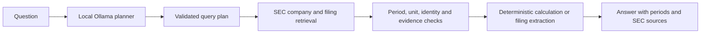

# FinSpect

FinSpect is an experimental financial research assistant for information in US SEC filings. A local Ollama model turns a question into a structured plan; FinSpect retrieves SEC evidence, checks company and period metadata, and uses deterministic Python calculations for supported numeric questions. Answers include periods and source evidence, and unsupported or ambiguous requests should fail closed.

> **Status: research prototype.** The deterministic report covers 20 question archetypes, currently classified as **20 PARTIAL, 0 PASS, 0 UNSUPPORTED, 0 FAIL**. PARTIAL means there is offline reference and pipeline coverage, but it is not a live accuracy score. Separate Q1, Q2, and Q3 year-over-year revenue gates each pass **3/3** source-linked references across NVIDIA, Microsoft, and Apple. SEC retrieval and planner interpretation have not been evaluated together across the benchmark. See [`reports/benchmark-report.json`](reports/benchmark-report.json) and [`IMPLEMENTATION_PLAN.md`](IMPLEMENTATION_PLAN.md).

## How it works



The Streamlit interface presents the plan, answer, and evidence from the same research pipeline. It does not calculate financial values in the browser. Voice requests go from Streamlit to a local FastAPI service bound to `127.0.0.1`; that service keeps the Gnani key server-side for both STT and TTS.

## Run locally (Windows PowerShell)

### 1. Install the project

Use Python 3.11 or newer. From the repository root:

```powershell
python -m venv .venv
.\.venv\Scripts\Activate.ps1
.\.venv\Scripts\python.exe -m pip install --upgrade pip
.\.venv\Scripts\python.exe -m pip install -e ".[dev]"
```

Use `\.venv\Scripts\python.exe` for the commands below so Streamlit, FinSpect, and the tests run under the same Python installation.

### 2. Configure SEC access and Ollama

SEC's public endpoints do not use an API key. SEC asks clients to identify themselves with a descriptive User-Agent and contact email. Set your own contact value in the terminal where Streamlit will run:

```powershell
$env:SEC_USER_AGENT = "FinSpect/0.1 contact your-email@example.com"
$env:FINSPECT_OLLAMA_MODEL = "qwen2.5-coder:3b"
$env:FINSPECT_OLLAMA_TIMEOUT = "300"
$env:FINSPECT_OLLAMA_NUM_CTX = "4096"
$env:FINSPECT_OLLAMA_NUM_PREDICT = "512"
```

Install the default model once if needed:

```powershell
ollama pull qwen2.5-coder:3b
```

Make sure Ollama is running. If it is not already running as a service, open another PowerShell window and run `ollama serve`. The default endpoint is `http://localhost:11434`; set `FINSPECT_OLLAMA_URL` if yours is different.

### 3. (Optional) Configure Gnani voice

Text questions need no Gnani credentials. For voice, paste your single shared key into the local, Git-ignored file `D:\Finspect\v0.1\.streamlit\secrets.toml` (create the `.streamlit` folder if needed):

```toml
GNANI_API_KEY_ID = "[Paste API Key]"
```

Replace `[Paste API Key]` with your Gnani API key ID locally. This file is ignored by Git. The FastAPI voice service reads the key server-side and sends it in Gnani's `X-API-Key-ID` header for both STT and TTS; the dashboard never displays or accepts keys. Restart the voice service after adding or changing the key. Do not put credentials in source code, screenshots, chat, or commits. Real STT/TTS account calls have not yet been verified.

### 4. Start the local voice backend

Open a second PowerShell window at the repository root and run:

```powershell
.\.venv\Scripts\python.exe -m uvicorn finspect.voice_api:app --app-dir src --host 127.0.0.1 --port 8001
```

The service binds only to the local computer. Confirm it is ready at `http://127.0.0.1:8001/health`; `gnani_configured` should be `true`. The health response never includes the key. If you prefer a different local port, set `FINSPECT_VOICE_API_URL` in the Streamlit terminal to the matching local URL.

### 5. Start Streamlit

In the PowerShell window with the SEC settings, run:

```powershell
$env:FINSPECT_VOICE_API_URL = "http://127.0.0.1:8001"
.\.venv\Scripts\python.exe -m streamlit run src/finspect/app.py
```

Open the local URL Streamlit prints, usually `http://localhost:8501`. Try a bounded supported question such as:

> For NVIDIA, what was the year-over-year revenue growth in fiscal Q1 2025 compared with fiscal Q1 2024?

### Open it from another device or over the internet

The checked-in `.streamlit/config.toml` binds Streamlit to `0.0.0.0`, so another device on the same LAN can open the Streamlit Network URL (typically `http://<computer-LAN-IP>:8501`). Windows Firewall must allow the Python/Streamlit process on that private network. The FastAPI voice service remains bound to loopback; Streamlit calls it server-side.

Browsers allow microphone capture on `localhost` or HTTPS, but block it on plain HTTP LAN/IP addresses. For a temporary HTTPS preview, keep Streamlit and FastAPI running, then open a fourth PowerShell window and run a Cloudflare Quick Tunnel:

```powershell
cloudflared tunnel --url http://127.0.0.1:8501 --allowed-mail "your-email@example.com"
```

Open the `https://…trycloudflare.com` address printed by the command and enter the allowed email/PIN. Replace the example email with your own. Keep the tunnel terminal open. This is a temporary preview; anyone who can pass the email check can access the app, and the URL stops working when the process stops. Do not expose the app without access protection.

The quarterly reference gates cover Q1–Q3 revenue growth. Q2/Q3 pipeline checks use deterministic period-matched SEC fact fixtures; live SEC and planner interpretation remain unevaluated. For annual examples, try Microsoft's FY2024-to-FY2025 revenue growth or an NVIDIA annual operation. Check the result's periods, values, units, and SEC filing links before relying on it.

### If the local model is slow or runs out of context

FinSpect sends a compact planning prompt and schema, not the full chat history. Ollama requests use a 4,096-token context by default and allow 300 seconds for the planner response. A larger context uses more memory; raise `FINSPECT_OLLAMA_NUM_CTX` only if Ollama reports a context-length error and your machine has enough memory. If the client times out while the model is still responding, raise `FINSPECT_OLLAMA_TIMEOUT` (for example, to `600`); this waits longer but does not make inference faster. Keep `FINSPECT_OLLAMA_NUM_PREDICT` near `512` for the structured plan output.

## Check whether it is working

Run the automated suite and regenerate the deterministic benchmark report from the repository root:

```powershell
.\.venv\Scripts\python.exe -m pytest -q
.\.venv\Scripts\python.exe -m finspect.benchmark_eval --output reports/benchmark-report.json
```

The expected current baseline is **326 passing tests** and a report with **20 PARTIAL, 0 FAIL**. The report includes per-operation reference matrices; check their case counts and failed checks, not just the aggregate. For each Q1, Q2, and Q3 revenue slice, expect 3 cases and 3 passes for NVDA, MSFT, and AAPL. The YTD-derived Q2/Q3 matrix has 6/6 passes across the same issuers. These checks use fixed references and mocks, so they do not prove that today's SEC response or an LLM plan will be correct.

For a local live smoke check, verify that (1) Ollama is reachable and has the selected model, (2) the app starts without a configuration error, (3) a question returns a plan and answer, and (4) each cited filing, period, unit, and calculation agrees with the SEC filing. A live SEC request needs internet access and a valid `SEC_USER_AGENT`. Stop if the planner picks the wrong issuer, fiscal period, metric, or evidence; record the question and result as a benchmark case before treating the issue as fixed.

If Streamlit reports `ModuleNotFoundError: No module named 'finspect'`, run this from the repository root:

```powershell
.\.venv\Scripts\python.exe -m streamlit run src/finspect/app.py
```

The app entry point also adds its local `src` directory to Python's import path when Streamlit executes the script directly.

## Current coverage and limits

- The annual pipeline supports the implemented Q01–Q20 archetypes across financial statements, segments, cash allocation, equity, commitments, risks, legal proceedings, market-risk disclosures, and selected narrative questions. Support and reference depth vary by operation; the benchmark report and [`data/benchmark`](data/benchmark) are the source of truth for individual cases.
- Q1–Q3 year-over-year revenue growth has source-linked NVIDIA, Microsoft, and Apple references across different fiscal calendars and deterministic pipeline checks. For Q2/Q3, the resolver uses a direct standalone fact when available or derives it by subtracting consecutive original 10-Q YTD facts; it fails closed when periods, concepts, or filings do not align. Six YTD-derived references and mocked resolver-to-answer pipeline cases cover all three issuers; live SEC company-facts integration and wider sector coverage remain open. Q4, direct YTD answers, and quarter-to-quarter comparisons are not implemented.
- Annual reference matrices include NVIDIA, Microsoft, Apple, CVS Health, PepsiCo, and Amazon across operations. Coverage is uneven and remains limited; it does not establish support for every US-listed company or every question.
- Live SEC retrieval and Ollama planning have not been comprehensively tested together against the reference benchmark. The checked-in report is deterministic and does not make an overall accuracy claim.
- A local planner-only sweep of all 20 templates with `qwen2.5-coder:3b` returned schema-valid plans for 15/20; five were rejected by validation, and some valid plans selected the wrong operation or benchmark ID. This was not an answer-accuracy test. The SEC User-Agent was not configured for that run, so no live SEC answer sweep was performed.
- Q20 topic matching is bounded and is not an exhaustive risk analysis or validated materiality ranking. Narrative extraction has heuristic limits.
- Custom issuer tags, IFRS data, FX conversion, and disclosures that are missing, ambiguous, or incompatible with the requested periods may be unsupported. FinSpect is a prototype, not financial advice; verify important results against the cited filing.

## Next implementation priorities

1. Extend quarterly references to additional sectors and Q4/direct-YTD questions, then verify the resolver against live SEC company facts and original/amended filing cases.
2. Add source-backed cases for more sectors and less-covered operations, and test both live SEC retrieval and planner interpretation against expected references.
3. Complete a Streamlit research-flow smoke check and Gnani STT/TTS account check with secrets configured locally; document any deployment-specific setup.
4. Expand only after a question type has clear reference cases. Keep unsupported behavior explicit instead of guessing.

See [`IMPLEMENTATION_PLAN.md`](IMPLEMENTATION_PLAN.md) for the ordered benchmark gates and exit criteria.

## Gnani API notes

The optional voice flow uses Gnani Prisma v2.5 for speech-to-text (`/stt/v3`) and Timbre v2.5 for text-to-speech (`/api/v1/tts/inference`). The app shows the transcript for review before research and speaks only a concise result summary; written answers and SEC evidence remain visible. See the [Gnani STT guide](https://docs.gnani.ai/api/STT/speech-to-text) and [Gnani TTS guide](https://docs.gnani.ai/api/TTS/tts-inference). Automated tests mock provider requests; a real account call remains to be done.

There is no hosted LLM API key in the current text workflow: Ollama runs locally. SEC access uses the descriptive `SEC_USER_AGENT`, not a secret. Keep Gnani credentials server-side, and rotate them if they are exposed.
