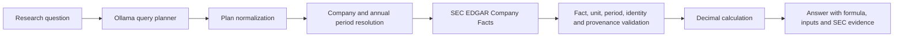

# FinSpect

FinSpect is an experimental financial research system. It uses a language model to interpret a question, SEC filing data to supply financial inputs, validation rules to reject incompatible facts, and deterministic Python calculations to produce an answer with its periods and sources.

> **Prototype status:** the current end-to-end calculation paths cover annual revenue growth, absolute annual revenue change, and annual operating margin change. The 20-question benchmark is not broadly supported. The current reproducible evaluation is **2 PARTIAL, 18 UNSUPPORTED**; see [`reports/benchmark-report.json`](reports/benchmark-report.json).

## Problem

Financial research requires finding the right company, concept, reporting period, and unit across filings before doing any calculation. A general-purpose LLM can mix periods, select the wrong metric, or invent values and citations. FinSpect separates those responsibilities:

**LLMs interpret questions. Validated filing data and deterministic code calculate.**

## Architecture



The Streamlit application calls the same orchestrator. It displays the structured plan and evidence returned by the pipeline; it does not calculate financial values in the UI.

## Current capabilities

- SEC company and filing metadata retrieval, plus XBRL Company Facts retrieval.
- Structured query plans validated with Pydantic.
- Deterministic company identity, annual period, unit, entity, and provenance checks.
- Q01 annual revenue growth and absolute annual revenue change in the orchestrator.
- Q03 annual operating margin change from SEC revenue and operating-income facts.
- Decimal-based calculator functions for benchmark formulas; registration does **not** mean an operation is wired end to end.
- Evidence-bearing answers with reporting periods, filing dates, accession numbers, and SEC URLs.
- An initial filing parser and keyword-ranked narrative passage retriever. Disclosure answers are not enabled end to end.

## Setup

Use Python 3.11 or newer. From the repository root:

```powershell
python -m pip install -e ".[dev]"
```

Set a descriptive SEC User-Agent and start a local Ollama server with a model that supports structured JSON output:

```powershell
$env:SEC_USER_AGENT = "FinSpect/0.1 contact you@example.com"
$env:FINSPECT_OLLAMA_MODEL = "qwen2.5-coder:3b"
```

Run the app:

```powershell
python -m streamlit run src/finspect/app.py
```

The application needs internet access for SEC requests and a reachable Ollama endpoint. `FINSPECT_OLLAMA_URL` can override the default local endpoint. No Gnani AI credential is needed by the current application.

## Tests and benchmark evaluation

Run deterministic tests:

```powershell
python -m pytest -q
```

Generate the benchmark report:

```powershell
python -m finspect.benchmark_eval --output reports/benchmark-report.json
```

The checked-in NVIDIA FY2024/FY2025 snapshots provide repeatable Q01 and Q03 checks. Revenue inputs are USD 60.922 billion and USD 130.497 billion, producing **114.20%** growth. Operating income is USD 32.972 billion and USD 81.453 billion; the operating margin increased **8.30 percentage points**. Values and filing provenance are from the [FY2024 Form 10-K](https://www.sec.gov/Archives/edgar/data/1045810/0001045810-24-000029-index.htm) and [FY2025 Form 10-K](https://www.sec.gov/Archives/edgar/data/1045810/0001045810-25-000023-index.htm).

The Q01 and Q03 reports are **PARTIAL** because they use checked-in filing snapshots and validated fixture plans; they do not run live SEC retrieval or the Ollama planner. Q02, Q04–Q20 are **UNSUPPORTED** by the current retrieval-to-answer pipeline. No benchmark accuracy percentage is claimed. The benchmark itself contains generic question templates rather than fixed companies, filings, or reference answers.

## Demo

1. Install the project and set `SEC_USER_AGENT` and the Ollama model as shown above.
2. Start the application with Streamlit.
3. Ask: `Calculate NVIDIA's revenue growth from FY2024 to FY2025.` or `How did NVIDIA's operating margin change from FY2024 to FY2025?`
4. Inspect the plan, result, periods, formula, and SEC evidence shown with the answer.
5. For a deterministic offline calculation/evidence check, run the Q01 benchmark evaluator.

The live demo depends on Ollama and SEC availability. The benchmark snapshot is the reproducible demonstration when those services are unavailable.

## Gnani AI integration

Gnani AI speech-to-text and text-to-speech are **not implemented or live-tested**. The intended voice flow is speech input → Gnani transcription → existing FinSpect research pipeline → spoken summary, with the full cited answer still visible in the app. Integration will be added only after verifying the account's current API configuration and model documentation.

Keep API keys out of source code, chat, screenshots, logs, and commits. The repository ignores `.env` files and `.streamlit/secrets.toml`. For local Streamlit development, store secrets in a local ignored secrets file or use environment settings; for a hosted demo, use the host's secret store. Never place a key in a browser-visible component. Rotate it if it is exposed.

## Limitations and next work

- Only annual US SEC revenue growth, absolute revenue change, and operating margin change have complete calculation paths.
- The planner and SEC live integration have not been jointly benchmarked against reference answers.
- Quarterly periods, segment facts, balance-sheet calculations, and disclosure answers need complete retrieval-to-answer paths and tests.
- Narrative section extraction uses heuristics and keyword ranking; it is not yet reliable enough for material-risk answers.
- The benchmark has no fixed gold answers for its general templates. Evaluation needs declared company/filing snapshots and references for each question.
- Gnani STT/TTS, voice playback, CI, and a public demo recording remain future work.

FinSpect is a learning-focused prototype, not financial advice. Verify results against the cited filing before relying on them.
